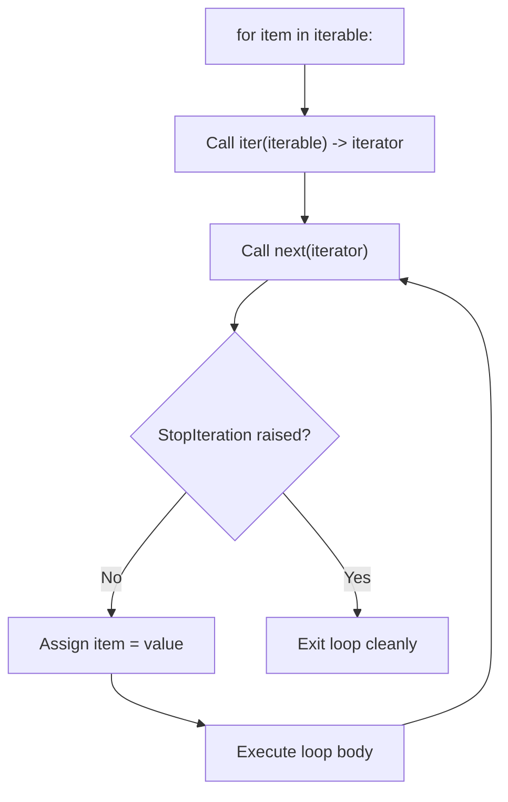

## What you will learn

- The essential distinction between **indefinite iteration** (using `while` loops) and **definite iteration** (using `for` loops).
- How the `for` statement extracts elements from an iterable sequence one by one until exhausted.
- The three argument variations of the built-in `range()` generator: `range(stop)`, `range(start, stop)`, and `range(start, stop, step)`.
- How to construct downward countdown loops using negative step arguments.
- Why Python's `range()` object is memory-efficient and never pre-allocates millions of integers in RAM.
- Applying the **accumulator pattern** to compute aggregate values such as sums, factorials, and running totals.
- How CPython executes for loops behind the scenes using the `iter()` and `next()` iterator protocol.

## Why this matters

In computing and data processing, you constantly encounter collections of items that must be processed one at a time. A banking system processes all transactions recorded across an account over the last thirty days; an e-commerce inventory system updates stock levels across fifty warehouse items; an image processing tool adjusts brightness pixel by pixel across millions of coordinates; and a text analyzer tallies character frequencies across an entire book. 

While a `while` loop requires manual loop counter initialization, manual condition maintenance, and manual counter incrementation—creating opportunities for infinite loops when an increment is omitted—a Python `for` loop manages traversal automatically. It knows exactly where a sequence begins, pulls the next element on every step, and terminates cleanly when the sequence concludes. Mastering `for` loops and `range()` gives you the premier tool for processing structured data reliably.

## The big idea

Imagine a carousel luggage conveyor belt at an airport arrivals hall. A passenger stands beside the belt to collect seven suitcases belonging to an athletic tour group. The belt slowly rotates, presenting one suitcase at a time. 

Notice how the passenger works:
1. When suitcase #1 arrives, the passenger lifts it off, checks the luggage tag, and places it on a baggage trolley.
2. The conveyor automatically advances, bringing suitcase #2 into reach.
3. The passenger repeats the exact same inspection and loading procedure for suitcase #2, suitcase #3, and so on.
4. When all seven suitcases have been collected, the passenger does not keep waiting forever; they know the batch is finished, pack up their trolley, and head toward the exit.

In Python, a **`for` loop** is that exact traveler standing beside the conveyor belt. The conveyor belt is any **iterable sequence** (such as a word made of characters, a list of items, or a numerical sequence produced by `range()`). On each iteration of the loop, Python takes the next item from the sequence, assigns it to a loop variable, executes your indented block of code, and advances to the next item automatically. When the conveyor runs empty, the loop terminates cleanly.

## Step by step

### 1. Definite iteration with `range(stop)`

The simplest form of `range(n)` generates a sequence of integers starting at `0` and continuing up to, but not including, `n` (the `stop` boundary).

```python run
for count in range(5):
    print("Lap completed:", count + 1)
```

```output
Lap completed: 1
Lap completed: 2
Lap completed: 3
Lap completed: 4
Lap completed: 5
```

In line 1, `range(5)` produces the integers `0, 1, 2, 3, 4`. On each turn of the loop, the variable `count` receives the next integer in the sequence. Line 2 adds `1` to `count` for human-friendly lap numbering (`1` through `5`). After lap 5, the sequence is exhausted and execution advances beyond the loop block.

### 2. Custom intervals with `range(start, stop, step)`

Supplying three arguments to `range()` gives you complete control over the starting point, the non-inclusive stop boundary, and the stride between numbers:
- `start`: The first number in the sequence.
- `stop`: The upper boundary (never reached).
- `step`: The amount added on each iteration.

```python run
for num in range(2, 11, 2):
    print("Even number:", num)
```

```output
Even number: 2
Even number: 4
Even number: 6
Even number: 8
Even number: 10
```

`range(2, 11, 2)` begins at `2`, adds `2` on each iteration, and stops before reaching `11`. The loop iterates across `2, 4, 6, 8, 10`.

### 3. Countdown loops with negative steps

When you supply a negative `step` value, `range()` counts downward. For a negative step, `start` must be strictly greater than `stop`.

```python run
for countdown in range(5, 0, -1):
    print("T-minus:", countdown)
print("Rocket launch!")
```

```output
T-minus: 5
T-minus: 4
T-minus: 3
T-minus: 2
T-minus: 1
Rocket launch!
```

Line 1 starts at `5`, decrements by `1` on each step, and halts before `0` (so `1` is the final value processed). Once the loop completes, line 3 displays the launch message.

### 4. Iterating directly over text strings

Because a string in Python is an ordered sequence of characters, you can pass a string directly to a `for` loop without calling `range()` or measuring `len()`.

```python run
word = "Python"
for char in word:
    print("Character:", char)
```

```output
Character: P
Character: y
Character: t
Character: h
Character: o
Character: n
```

Python automatically steps through `'Python'` one character at a time, binding `char` to `'P'`, then `'y'`, `'t'`, `'h'`, `'o'`, and `'n'`. This pattern is called **direct sequence iteration**.

### 5. The accumulator pattern: financial savings tracker

One of the most foundational patterns in computer programming is the **accumulator pattern**. You initialize an accumulator variable before the loop, update it during each iteration, and inspect the final total when the loop finishes.

```python run
total_savings = 0
monthly_deposit = 2500
for month in range(1, 7):
    total_savings += monthly_deposit
    print(f"Month {month}: Saved ₹{total_savings}")
```

```output
Month 1: Saved ₹2500
Month 2: Saved ₹5000
Month 3: Saved ₹7500
Month 4: Saved ₹10000
Month 5: Saved ₹12500
Month 6: Saved ₹15000
```

Line 1 initializes `total_savings` to zero. Line 3 sets up a loop over months 1 through 6 (`range(1, 7)`). In line 4, each iteration adds `2500` to the running total using the augmented assignment operator `+=`, tracking cumulative deposits up to `15000`.

### 6. Sports simulation: bowling a cricket over

In cricket, a standard over consists of exactly six legal deliveries. A `for` loop models this physical sequence cleanly.

```python run
for ball in range(1, 7):
    print(f"Over 1, Ball {ball}: bowled")
```

```output
Over 1, Ball 1: bowled
Over 1, Ball 2: bowled
Over 1, Ball 3: bowled
Over 1, Ball 4: bowled
Over 1, Ball 5: bowled
Over 1, Ball 6: bowled
```

`range(1, 7)` generates integers 1 through 6, executing the print block exactly six times, once per delivery.

### 7. Multiplicative accumulation: calculating factorials

The accumulator pattern works with multiplication just as easily as addition. To calculate a factorial ($n! = 1 \times 2 \times \dots \times n$), initialize the accumulator to `1` (the multiplicative identity) and multiply by each integer in sequence.

```python run
n = 5
factorial = 1
for factor in range(1, n + 1):
    factorial *= factor
print(f"Factorial of {n}:", factorial)
```

```output
Factorial of 5: 120
```

`factorial` begins at `1`. The loop iterates from `1` through `5` (`range(1, 6)`), multiplying `1 * 1 * 2 * 3 * 4 * 5` to calculate `120`.

### 8. Lazy sequences: how `range()` saves system memory

In Python 3, `range()` does not construct a massive list of numbers in memory. Instead, it creates a lightweight generator object that stores only three integers: `start`, `stop`, and `step`.

```python run
numbers_range = range(1, 1000000)
print("Range object representation:", repr(numbers_range))
print("Start:", numbers_range.start, "Stop:", numbers_range.stop, "Step:", numbers_range.step)
```

```output
Range object representation: range(1, 1000000)
Start: 1 Stop: 1000000 Step: 1
```

Whether you create `range(1, 10)` or `range(1, 1000000000)`, the range object consumes the exact same tiny amount of memory (48 bytes in CPython). It calculates numbers on-the-fly only when the loop requests the next value.

## What Python is doing behind the scenes

When CPython executes a `for` loop, it invokes Python's formal **iterator protocol**:



| Step in Iterator Protocol | Action Performed by Python Virtual Machine |
| :--- | :--- |
| **1. Initialization** | Calls `iter()` on the sequence, obtaining an iterator object holding internal state. |
| **2. Fetching (`next()`)** | Executes the bytecode instruction `FOR_ITER`, which calls `next()` on the iterator to retrieve the next element. |
| **3. Binding** | Binds the retrieved value to the loop target variable (e.g. `count`). |
| **4. Body Execution** | Runs the indented code statements inside the loop block. |
| **5. Termination** | When the iterator reaches the end of the sequence, it raises `StopIteration`. CPython catches this exception internally and exits the loop without crashing. |

## Common mistakes

### 1. The off-by-one boundary error with `range()`

Because `range(start, stop)` halts *before* reaching `stop`, writing `range(1, 5)` iterates only four times: `1, 2, 3, 4`. If you want to include `5`, the stop boundary must be `6`.

Broken code:
```python
# Intended to count 1 to 5 inclusive
for i in range(1, 5):
    print("Count:", i)
```

Actual output:
```output
Count: 1
Count: 2
Count: 3
Count: 4
```

How to fix it: add 1 to the upper boundary whenever you want inclusive endpoints:
```python run
for i in range(1, 6):
    print("Inclusive count:", i)
```

```output
Inclusive count: 1
Inclusive count: 2
Inclusive count: 3
Inclusive count: 4
Inclusive count: 5
```

### 2. Expecting downward counts without a negative step

Writing `range(5, 0)` produces an empty sequence because the default step is positive `+1`. Python cannot count up from 5 to reach 0, so the loop body never executes at all!

Broken code:
```python
for count in range(5, 0):
    print("This will never print!")
```

Actual output: (nothing printed)

How to fix it: supply `-1` as the explicit third argument:
```python run
for count in range(5, 0, -1):
    print("Counting down:", count)
```

```output
Counting down: 5
Counting down: 4
Counting down: 3
Counting down: 2
Counting down: 1
```

### 3. Modifying the loop variable inside the body

Modifying the loop variable inside the loop body (e.g. `i += 2`) does not alter the progression of a `for` loop in Python. On the next iteration, the loop simply overwrites the variable with the next element from the iterator.

Broken / Misunderstood code:
```python
for i in range(3):
    print("Start:", i)
    i = 100  # Will be overwritten on the next loop turn!
    print("End:", i)
```

Actual output:
```output
Start: 0
End: 100
Start: 1
End: 100
Start: 2
End: 100
```

How to fix it: if you need to skip steps dynamically, use a `while` loop (as covered in the while loops lesson) or adjust the `step` parameter of `range()`.

## Cheat sheet

| Pattern | Code Syntax | Values Generated |
| :--- | :--- | :--- |
| **0 to n-1** | `range(4)` | `0, 1, 2, 3` |
| **start to stop-1** | `range(3, 7)` | `3, 4, 5, 6` |
| **step intervals** | `range(1, 10, 2)` | `1, 3, 5, 7, 9` |
| **downward count** | `range(5, 0, -1)` | `5, 4, 3, 2, 1` |
| **direct string loop** | `for ch in "abc":` | `'a'`, then `'b'`, then `'c'` |
| **sum accumulator** | `total += num` | Adds to running balance |
| **product accumulator** | `prod *= num` | Multiplies running balance |

## Try it yourself

### Exercise 1 (easy): Multiplication table generator

Write a program that uses a `for` loop with `range(1, 11)` to print the multiplication table for the number `7` (from $7 \times 1 = 7$ up to $7 \times 10 = 70$), formatted using an f-string.

```python run
# Complete the Multiplication table generator task.
# Sample data: multiplier = 7
# Write your code below and print the result
```


:::solution Solution
Iterate from 1 through 10 using `range(1, 11)` and multiply by 7:

```python run
multiplier = 7
for step in range(1, 11):
    product = multiplier * step
    print(f"{multiplier} x {step} = {product}")
```

```output
7 x 1 = 7
7 x 2 = 14
7 x 3 = 21
7 x 4 = 28
7 x 5 = 35
7 x 6 = 42
7 x 7 = 49
7 x 8 = 56
7 x 9 = 63
7 x 10 = 70
```
:::

### Exercise 2 (medium): Vowel counter in a sentence

Given the phrase `sentence = "Coding in Python is deeply rewarding"`, write a `for` loop that iterates through every character, checks if the lowercase character is a vowel (`ch in "aeiou"`), and accumulates the count into `vowel_count`. Print the final tally.

```python run
# Complete the Vowel counter in a sentence task.
# Sample data: sentence = 'Coding in Python is deeply rewarding'
# Write your code below and print the result
```


:::solution Solution
Traverse `sentence` directly, convert each character to lowercase, test with `in "aeiou"`, and increment `vowel_count`:

```python run
sentence = "Coding in Python is deeply rewarding"
vowel_count = 0
for char in sentence:
    if char.lower() in "aeiou":
        vowel_count += 1
print(f"Total vowels found: {vowel_count}")
```

```output
Total vowels found: 10
```
:::

### Exercise 3 (challenge): Sum of odd squares

Using a `for` loop and `range()`, calculate the sum of the squares ($i^2$) of all odd numbers between `1` and `15` inclusive ($1^2 + 3^2 + 5^2 + \dots + 15^2$). Print each term as it is calculated and display the final sum.

```python run
# Complete the Sum of odd squares task.
# Sample data: total_odd_squares = 0
# Write your code below and print the result
```


:::solution Solution
Use `range(1, 16, 2)` to generate odd integers, square each with `** 2`, and accumulate the sum:

```python run
total_odd_squares = 0
for odd_num in range(1, 16, 2):
    square = odd_num ** 2
    total_odd_squares += square
    print(f"{odd_num}^2 = {square:>3} (Running sum: {total_odd_squares})")
print("Final total of odd squares:", total_odd_squares)
```

```output
1^2 =   1 (Running sum: 1)
3^2 =   9 (Running sum: 10)
5^2 =  25 (Running sum: 35)
7^2 =  49 (Running sum: 84)
9^2 =  81 (Running sum: 165)
11^2 = 121 (Running sum: 286)
13^2 = 169 (Running sum: 455)
15^2 = 225 (Running sum: 680)
Final total of odd squares: 680
```
:::

## Recap

- Definite iteration with `for` loops traverses sequences automatically until exhausted.
- `range(stop)` generates numbers from `0` to `stop - 1`.
- `range(start, stop)` generates numbers from `start` to `stop - 1`.
- `range(start, stop, step)` adds `step` on each iteration; use negative steps for countdowns.
- `range()` is a memory-efficient sequence that calculates values on-the-fly without allocating lists in memory.
- Strings can be traversed character-by-character directly without index measuring.
- The **accumulator pattern** maintains running totals across iterations for sums, products, and aggregates.

Reference: Python documentation, The for statement
