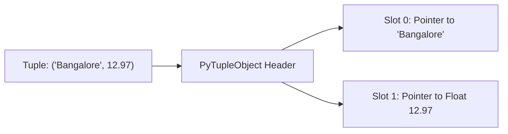

## What you will learn

- How Python defines **tuples** as ordered, immutable sequences of data.
- The single-element tuple syntax trap: why `(42)` is an integer while `(42,)` is a tuple.
- How **tuple packing** groups multiple values into a single compound object.
- How **tuple unpacking** distributes items across multiple independent variables in one step.
- Swapping variable values cleanly without declaring temporary intermediate variables (`a, b = b, a`).
- Capturing variable-length tails using extended star unpacking (`first, *middle, last = seq`).
- The philosophical and technical reasons for choosing tuples over lists in professional software design.
- Why tuples can serve as dictionary keys and set elements (hashability) whereas lists cannot.

## Why this matters

When designing reliable software architectures, data integrity is paramount. If your application models physical geographic coordinates like Bangalore's latitude and longitude `(12.9716, 77.5946)`, you do not want an errant function accidentally appending a third number, reordering the axes, or modifying the latitude in-place. If your program handles RGB pixel values `(255, 128, 0)`, that trio represents a single unified color value where the count and position of channels must remain permanently invariant.

A **tuple** is Python's dedicated tool for representing fixed, immutable records. Tuples communicate clear architectural intent: they signal to other programmers and to the Python runtime that this collection is a sealed snapshot that should never change during program execution. Furthermore, because tuples are immutable, Python optimizes their memory footprint and execution speed, making them faster to allocate and safer to share across multi-threaded applications.

## The big idea

Imagine a legal notary stamping an official paper contract containing a client's birthdate, passport number, and nationality: `("1995-04-12", "Z1234567", "Indian")`. 

Once the red wax seal is pressed onto the paper, that document is sealed. You cannot slide an extra clause into the middle of the contract; you cannot erase the passport number and write a different number over it; and you cannot delete the nationality. If circumstances change and new terms are required, you must draft a brand-new contract from scratch.

Contrast this with a dry-erase whiteboard hanging in a family kitchen: family members write shopping items on it, erase completed errands with a felt sponge, and scribble extra notes at the bottom throughout the week.

In Python:
- The dry-erase whiteboard is a **list**: mutable, dynamic, designed for continuous adding and removing.
- The wax-sealed contract is a **tuple**: immutable, fixed, designed for reliable record-keeping where accidental alteration must be prevented.

## Step by step

### 1. Declaring tuples and the single-element comma rule

Tuples are typically created by enclosing comma-separated values in parentheses `(...)`. However, in Python, it is actually the **comma** that defines a tuple, not the parentheses! A single value inside parentheses without a comma is treated merely as grouped arithmetic.

```python run
single_fake = (42)
single_real = (42,)
print("Type of (42):", type(single_fake))
print("Type of (42,):", type(single_real))
```

```output
Type of (42): <class 'int'>
Type of (42,): <class 'tuple'>
```

Line 1 assigns `(42)` without a trailing comma, which Python evaluates as an integer `int`. Line 2 includes the vital trailing comma `(42,)`, successfully creating a 1-element `tuple`.

### 2. Tuple unpacking into multiple variables

Tuple unpacking allows you to assign the elements of a tuple to individual variable identifiers in a single, balanced assignment statement.

```python run
gps_coordinate = (12.9716, 77.5946)
latitude, longitude = gps_coordinate
print("Extracted Latitude:", latitude)
print("Extracted Longitude:", longitude)
```

```output
Extracted Latitude: 12.9716
Extracted Longitude: 77.5946
```

In line 2, Python unpacks the 2-element tuple on the right, binding `latitude` to `12.9716` and `longitude` to `77.5946`. The number of variable names on the left must exactly match the number of elements in the tuple.

### 3. Elegant variable swapping without temporary variables

In traditional languages like C or Java, swapping the values of two variables requires declaring a temporary placeholder variable (`temp = a; a = b; b = temp`). In Python, tuple packing and unpacking performs this swap in a single elegant line.

```python run
player_x = 100
player_y = 250
player_x, player_y = player_y, player_x
print("Swapped X:", player_x)
print("Swapped Y:", player_y)
```

```output
Swapped X: 250
Swapped Y: 100
```

On line 3, Python first packs the right-hand values `(player_y, player_x)` into a temporary tuple in memory `(250, 100)`, then immediately unpacks them into the left-hand variables `player_x` and `player_y`, completing the swap without collision.

### 4. Extended unpacking with the star `*` operator

Introduced in PEP 3132, extended unpacking allows you to capture variable-length slices using a starred identifier `*rest`.

```python run
race_results = ["Gold", "Silver", "Bronze", "Fourth", "Fifth"]
first, second, third, *runners_up = race_results
print("Podium winners:", first, second, third)
print("Other finishers:", runners_up)
```

```output
Podium winners: Gold Silver Bronze
Other finishers: ['Fourth', 'Fifth']
```

The first three podium positions are bound to individual scalar variables, while `*runners_up` gathers all remaining trailing finishers into a list `['Fourth', 'Fifth']`.

### 5. Accessing elements by index and length

Like lists and strings, tuples support zero-based positive indexing, negative indexing, and the `len()` function.

```python run
rgb_color = (255, 128, 0)
print("Red channel:", rgb_color[0])
print("Green channel:", rgb_color[1])
print("Blue channel:", rgb_color[2])
print("Total channels:", len(rgb_color))
```

```output
Red channel: 255
Green channel: 128
Blue channel: 0
Total channels: 3
```

Lines 2 through 4 access the red, green, and blue intensity channels using indices `0`, `1`, and `2`. Line 5 reports the total channel count (`3`).

### 6. Tuple methods: `.count()` and `.index()`

Because tuples are immutable, they do not possess mutating methods like `.append()`, `.pop()`, or `.sort()`. They only offer non-destructive inspection methods:
- `.count(value)`: Returns how many times a value appears.
- `.index(value)`: Returns the zero-based index of the first matching value.

```python run
inventory_log = ("laptop", "mouse", "keyboard", "mouse")
print("Occurrences of mouse:", inventory_log.count("mouse"))
print("First index of keyboard:", inventory_log.index("keyboard"))
```

```output
Occurrences of mouse: 2
First index of keyboard: 2
```

Line 2 counts that `'mouse'` appears twice. Line 3 locates the first occurrence of `'keyboard'` at index 2.

### 7. Tuples containing mutable elements

A famous nuance of Python's object model is that while a tuple itself cannot have its slots reassigned, an object *inside* a tuple slot may be mutable!

```python run
nested_tuple = ([1, 2], "constant")
nested_tuple[0].append(3)
print("Mutated inner list inside tuple:", nested_tuple)
```

```output
Mutated inner list inside tuple: ([1, 2, 3], 'constant')
```

`nested_tuple[0]` points to a list. The pointer stored in the tuple remains completely unchanged; however, the underlying list object modified its own internal contents. (For true immutability, ensure all nested elements are also tuples).

### 8. Memory efficiency: tuples versus lists

For equal small collections, a tuple often uses less memory than a list in CPython. Exact byte counts depend on the Python build and platform, so do not write a program that depends on a particular size value.

```python run
import sys
sample_list = [1, 2, 3, 4, 5]
sample_tuple = (1, 2, 3, 4, 5)
list_size = sys.getsizeof(sample_list)
tuple_size = sys.getsizeof(sample_tuple)
print("Tuple uses fewer bytes:", tuple_size < list_size)
```

```output
Tuple uses fewer bytes: True
```

The example compares the measurements from this Python runtime without displaying implementation-specific byte counts. If your program needs to add, remove, or change items, choose a list for those behaviors; use a tuple when the values form a fixed record.

## What Python is doing behind the scenes

Under the hood, CPython implements tuples via the **`PyTupleObject`** structure:

| Architectural Property | Technical Detail in CPython |
| :--- | :--- |
| **Memory Layout** | Flat, contiguous C array of pointers stored immediately adjacent to the object header. |
| **No Over-allocation** | Size is allocated once during creation; no spare slots are maintained. |
| **Free List Cache** | CPython maintains internal recycled memory caches for small tuples (up to 20 elements) to make instantiation extremely fast. |
| **Hashability** | If all items within a tuple are hashable (immutable), the tuple computes a fixed hash value, allowing it to act as a dictionary key or set element. |



## Common mistakes

### 1. Forgetting the trailing comma for single-element tuples

Writing `x = ("hello")` does not create a tuple; it creates a string. Python requires a trailing comma for single-element tuples.

Broken code:
```python
user_tag = ("VIP")
print(type(user_tag))  # <class 'str'>, not tuple!
```

Actual output:
```output
<class 'str'>
```

How to fix it: always include a comma: `user_tag = ("VIP",)`.

### 2. Attempting item assignment on a tuple

Because tuples are immutable, attempting to overwrite an index position raises a `TypeError`.

Broken code:
```python
point = (10, 20)
point[0] = 50
```

Real error message:
```output
TypeError: 'tuple' object does not support item assignment
```

How to fix it: if you need to modify elements, use a `list`, or create a new tuple using concatenation:
```python run
point = (10, 20)
new_point = (50, point[1])
print("Updated tuple record:", new_point)
```

```output
Updated tuple record: (50, 20)
```

### 3. Value unpacking count mismatch

If the number of variables on the left of an assignment does not match the tuple length on the right, Python raises a `ValueError`.

Broken code:
```python
coords = (10, 20, 30)
x, y = coords  # Expects 2, but tuple has 3!
```

Real error message:
```output
ValueError: too many values to unpack (expected 2)
```

How to fix it: supply matching variable counts, or use `*rest` to absorb leftover values:
```python run
coords = (10, 20, 30)
x, y, *z = coords
print(f"x={x}, y={y}, remaining={z}")
```

```output
x=10, y=20, remaining=[30]
```

## Cheat sheet

| Feature | Syntax Example | Notes |
| :--- | :--- | :--- |
| **Empty tuple** | `t = ()` | Zero-element tuple |
| **Single-item tuple**| `t = (5,)` | **Comma required!** |
| **Multi-item tuple** | `t = (1, 2, 3)` | Parentheses optional if comma present |
| **Unpack variables** | `x, y = (10, 20)` | Distributes elements |
| **Variable swap** | `a, b = b, a` | Swaps values in place |
| **Star unpacking** | `head, *tail = t` | Gathers leftovers into list |
| **Count method** | `t.count(val)` | Counts occurrences |
| **Index method** | `t.index(val)` | Finds first zero-based index |
| **Length** | `len(t)` | Total elements |

## Try it yourself

### Exercise 1 (easy): Coordinate extraction and axis swap

Create a tuple holding two-dimensional GPS coordinates `location = (19.0760, 72.8777)` (Mumbai latitude and longitude). Unpack the tuple into `latitude` and `longitude`. Then, use tuple swapping syntax to swap their values so that `latitude` holds the longitude and vice-versa, printing the swapped result.

```python run
# Complete the Coordinate extraction and axis swap task.
# Sample data: location = (19.076, 72.8777)
# Write your code below and print the result
```


:::solution Solution
Unpack into `latitude, longitude`, then swap using `latitude, longitude = longitude, latitude`:

```python run
location = (19.0760, 72.8777)
latitude, longitude = location
latitude, longitude = longitude, latitude
print("Swapped latitude:", latitude)
print("Swapped longitude:", longitude)
```

```output
Swapped latitude: 72.8777
Swapped longitude: 19.076
```
:::

### Exercise 2 (medium): Race podium split with star unpacking

Given the leaderboard of a 100-meter sprint `leaderboard = ("Usain", "Yohan", "Justin", "Tyson", "Asafa")`, use extended unpacking to assign the gold winner to `gold`, the silver winner to `silver`, the bronze winner to `bronze`, and gather all remaining sprinters into `others`. Print the podium and the remaining runners.

```python run
# Complete the Race podium split with star unpacking task.
# Sample data: leaderboard = ('Usain', 'Yohan', 'Justin', 'Tyson', 'Asafa')
# Write your code below and print the result
```


:::solution Solution
Use `gold, silver, bronze, *others = leaderboard`:

```python run
leaderboard = ("Usain", "Yohan", "Justin", "Tyson", "Asafa")
gold, silver, bronze, *others = leaderboard
print(f"Gold: {gold}, Silver: {silver}, Bronze: {bronze}")
print("Runners-up:", others)
```

```output
Gold: Usain, Silver: Yohan, Bronze: Justin
Runners-up: ['Tyson', 'Asafa']
```
:::

### Exercise 3 (challenge): Perceived RGB color luminance

A digital graphics filter calculates perceived human brightness (luminance) from an RGB color tuple using the standardized formula: $L = (0.299 \times R) + (0.587 \times G) + (0.114 \times B)$. Given the color tuple `forest_green = (34, 139, 34)`, unpack the channels, calculate the luminance value, round it to one decimal place, and print the result.

```python run
# Complete the Perceived RGB color luminance task.
# Sample data: forest_green = (34, 139, 34)
# Write your code below and print the result
```


:::solution Solution
Unpack `red, green, blue` from the tuple, apply the weighted formula, and format with `:.1f`:

```python run
forest_green = (34, 139, 34)
red, green, blue = forest_green
luminance = (0.299 * red) + (0.587 * green) + (0.114 * blue)
print(f"Color: {forest_green} -> Perceived Luminance: {luminance:.1f}")
```

```output
Color: (34, 139, 34) -> Perceived Luminance: 95.6
```
:::

## Recap

- Tuples are ordered, **immutable** sequences defined with parentheses and commas.
- A single-element tuple strictly requires a trailing comma, like `(5,)`.
- Tuple unpacking assigns individual elements to multiple variables simultaneously.
- Tuple packing and unpacking allows swapping variables in one step: `a, b = b, a`.
- Use `*rest` to gather variable-length leftovers during unpacking.
- Tuples consume less memory and instantiate faster than lists in CPython.
- Use lists for mutable collections of items; use tuples for fixed, tamper-proof records.

Reference: Python documentation, Tuples
