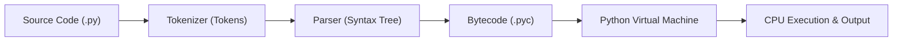

## What you will learn

- The core definition of **programming** as systematic, sequential problem-solving using formal language instructions.
- How computer hardware interacts with software, moving from high-level source code to low-level electrical signals.
- The fundamental architecture of an **interpreter** versus a traditional ahead-of-time compiler.
- How the reference implementation **CPython** compiles human-readable code into intermediate **bytecode** before running it.
- Why Python's readable design philosophy makes it the premier modern choice for web engineering, scientific computing, automation, and machine learning.

## Why this matters

Every digital convenience you interact with daily—from instant messaging apps and satellite navigation to banking ledgers and music recommendation algorithms—runs on written instructions. Computers possess enormous processing speed and flawless recall, yet they cannot guess intentions or interpret vague requests. Writing software is the process of translating human intuition, logic, and domain rules into unambiguous instructions that hardware can execute without confusion. Learning Python gives you the direct ability to automate tedious everyday tasks, analyze massive datasets, build web services, and command computing systems with remarkable clarity.

## The big idea

Think of a computer as an extraordinarily obedient commercial kitchen assistant who knows how to chop, boil, measure, and stir, but has zero culinary intuition. If you tell this assistant to "make something tasty for lunch," the assistant freezes because "tasty" is subjective and undefined. However, if you hand the assistant a precise, step-by-step recipe that specifies measuring 200 grams of flour, whisking two eggs for ninety seconds, and heating a pan to medium heat, the assistant executes each task flawlessly every single time.

A computer program is that exact recipe. Computer hardware understands only binary machine code—a staggering flood of ones and zeroes representing electrical switch states across billions of microscopic transistors on a silicon chip. Because writing raw binary instructions is tedious and error-prone for human brains, computer scientists created **high-level languages** like Python. Python sits between human natural language and raw silicon hardware. You write clean, expressive text using words like `print`, `for`, and `if`, and the Python engine translates your text into low-level machine instructions behind the scenes.

## Step by step

### 1. Computer instructions and sequential execution

Computers execute instructions sequentially from the top of your file to the bottom, following a strict chronological flow known as the **control flow**. When you instruct Python to display text using the built-in `print()` function, Python reads the statement, evaluates the inner content, and sends the resulting text to your terminal display output.

```python run
print('Welcome to Python programming!')
```

```output
Welcome to Python programming!
```

Line 1 invokes the `print()` function with a text string enclosed in quotes. Python immediately identifies the function call, verifies that the syntax conforms to the language grammar rules, and writes the character stream to the standard output device. Every program begins with simple instructions executed in orderly succession.

### 2. Performing computations and storing intermediate state

A program is far more than static text; it is an active engine for calculating values and tracking changing conditions. When you assign numbers to descriptive labels called **variables**, Python reserves memory storage and links that name to the underlying numerical value. You can then perform arithmetic using standard operators such as multiplication `*`, addition `+`, and division `/`.

```python run
hours_in_day = 24
minutes_per_hour = 60
seconds_per_minute = 60
total_seconds = hours_in_day * minutes_per_hour * seconds_per_minute
print('Seconds in a standard day:', total_seconds)
```

```output
Seconds in a standard day: 86400
```

In this script, lines 1 through 3 establish three named variables: `hours_in_day`, `minutes_per_hour`, and `seconds_per_minute`. On line 4, Python evaluates the arithmetic expression on the right-hand side of the `=` operator by multiplying twenty-four by sixty, then multiplying the intermediate result by sixty again. Finally, on line 5, `print()` receives a descriptive label alongside the calculated total, outputting both neatly separated by a space.

### 3. Combining text and arithmetic expressions

Python allows expressive manipulation of text data alongside numerical data. When you multiply a text string by an integer, Python does not attempt numerical math; instead, it duplicates the string sequence multiple times.

```python run
greeting = 'Code'
repeated_banner = greeting * 4
print(repeated_banner)
```

```output
CodeCodeCodeCode
```

Line 1 assigns the string `'Code'` to the variable `greeting`. Line 2 applies the multiplication operator `*` between the string and the integer `4`. Python understands that multiplying a sequence by an integer means string repetition, producing the concatenated string `'CodeCodeCodeCode'`. Line 3 prints the combined banner text to the output window.

### 4. High-level types: how Python categorizes data

In Python, every single piece of data has an associated **data type**. The data type informs the Python interpreter about how much memory to allocate, what operations are mathematically valid, and how the value should behave when manipulated. You can inspect the underlying type of any variable or literal using the built-in `type()` function.

```python run
print(type(100))
print(type(3.14159))
print(type('Antigravity'))
print(type(True))
```

```output
<class 'int'>
<class 'float'>
<class 'str'>
<class 'bool'>
```

Line 1 inspects the whole number `100`, which Python categorizes as `int` (integer). Line 2 inspects `3.14159`, which Python identifies as `float` (floating-point decimal number). Line 3 checks `'Antigravity'`, identifying it as `str` (string of textual characters). Line 4 evaluates `True`, identifying it as `bool` (Boolean logic state). Python dynamically determines these types at runtime without forcing you to write explicit type declarations beforehand.

### 5. Solving real domain problems: cricket run rates

To appreciate the power of software, consider how programming simplifies real calculations. In cricket, a team's run rate represents the average number of runs scored per six-ball over. Calculating this manually during a live match requires dividing total runs by overs bowled and rounding the decimal output.

```python run
total_runs = 186
overs_bowled = 20
run_rate = total_runs / overs_bowled
print('Match run rate:', round(run_rate, 2))
```

```output
Match run rate: 9.3
```

Line 1 records the total runs scored (`186`). Line 2 records completed overs (`20`). Line 3 calculates the quotient using the division operator `/`. Division in Python always yields a floating-point number. Line 4 uses Python's built-in `round()` function to limit the display to two decimal places, presenting a clear match metric of `9.3`.

### 6. Converting environmental data: temperature scales

Weather sensors across different regions record temperature in Celsius or Fahrenheit. Software acts as the universal bridge that ingests raw telemetry, applies exact mathematical transformations, and displays standardized readouts.

```python run
celsius_temp = 32
fahrenheit_temp = (celsius_temp * 9 / 5) + 32
print('Temperature in Fahrenheit:', fahrenheit_temp)
```

```output
Temperature in Fahrenheit: 89.6
```

Line 1 records a comfortable summer temperature of `32` degrees Celsius. Line 2 applies the standard conversion formula: multiply by nine, divide by five, and add thirty-two. Python evaluates parenthesized expressions first, adhering strictly to mathematical precedence rules. Line 3 prints the converted temperature of `89.6` Fahrenheit.

### 7. Tracking digital media: music playlist durations

Digital audio players store individual track lengths in seconds. To present human-friendly playlist summaries, audio software aggregates track seconds and converts them into decimal minutes.

```python run
song1_seconds = 215
song2_seconds = 190
song3_seconds = 255
total_minutes = (song1_seconds + song2_seconds + song3_seconds) / 60
print('Playlist duration in minutes:', round(total_minutes, 1))
```

```output
Playlist duration in minutes: 11.0
```

Lines 1 through 3 declare durations for three consecutive songs in seconds. Line 4 calculates the total sum within parentheses and divides by sixty to convert the duration to minutes. Line 5 rounds the resulting float to one decimal place, informing the listener that their playlist runs for approximately `11.0` minutes.

### 8. Financial modeling: event profit calculation

Software is the backbone of commercial accounting. By modeling ticket sales, attendance metrics, and fixed venue expenses, a simple script can project financial viability before an event occurs.

```python run
ticket_price = 150
attendees = 45
hall_rental = 2500
profit = (ticket_price * attendees) - hall_rental
print('Net concert profit:', profit)
```

```output
Net concert profit: 4250
```

Line 1 sets the admission ticket price to `150` dollars. Line 2 records `45` registered attendees. Line 3 defines the fixed hall rental fee of `2500` dollars. Line 4 calculates gross ticket revenue (`150 * 45 = 6750`) and subtracts the venue cost, storing the net profit of `4250`. Line 5 prints the financial summary.

## What Python is doing behind the scenes

When you click "Run" or pass a `.py` script to Python, your computer does not directly feed characters like `p-r-i-n-t` to the central processing unit (CPU). Instead, Python executes a multi-stage translation pipeline managed by **CPython**, the standard reference implementation written in the C language:

| Stage | Name | What happens during this phase |
| :--- | :--- | :--- |
| **Stage 1** | **Lexical Analysis (Tokenizing)** | The interpreter scans raw source text and breaks characters into discrete linguistic tokens (`NAME`, `OP`, `NUMBER`, `STRING`). |
| **Stage 2** | **Parsing (AST Construction)** | The parser arranges tokens into an **Abstract Syntax Tree (AST)**, validating grammatical rules and structural relationships. |
| **Stage 3** | **Bytecode Compilation** | The compiler traverses the AST and generates compact, platform-independent virtual instructions called **bytecode** (cached in `.pyc` files). |
| **Stage 4** | **Virtual Machine Execution** | The **Python Virtual Machine (PVM)** loops through bytecode instructions one by one, executing low-level C functions on your computer's CPU. |



Because this entire pipeline happens automatically in memory within fractions of a millisecond, Python gives you the immediate feedback of an interpreted scripting language while leveraging compiled bytecode execution under the hood.

## Common mistakes

### 1. Forgetting closing parentheses or quotation marks

Because Python parses code strictly according to formal syntax rules, omitting a closing parenthesis or quotation mark causes the parser to fail before execution even starts.

Broken code:
```python
print("Hello world"
```

Real error message:
```output
File "<string>", line 1
    print('Hello world'
         ^
SyntaxError: '(' was never closed
```

How to fix it: ensure every opening parenthesis `(` has a matching closing parenthesis `)`, and every opening quote has an identical closing quote:
```python run
print("Hello world")
```

```output
Hello world
```

### 2. Misspelling identifiers and function names

Python is strictly case-sensitive and literal. If you mistype a variable name or function identifier, Python searches its namespace, fails to locate the identifier, and raises a runtime exception.

Broken code:
```python
print(pythn)
```

Real error message:
```output
Traceback (most recent call last):
  File "<string>", line 1, in <module>
    print(pythn)
          ^^^^^
NameError: name 'pythn' is not defined
```

How to fix it: inspect your spelling carefully. If you intended to print a literal string of text, enclose it in quotes. If you intended to print a variable, verify that the variable was assigned earlier with the exact same spelling:
```python run
python_name = "Python 3.12"
print(python_name)
```

```output
Python 3.12
```

### 3. Attempting mathematically impossible operations

Computers adhere to formal mathematical laws. Dividing any number by zero is mathematically undefined, and Python immediately halts execution with an explicit exception rather than producing corrupted state.

Broken code:
```python
speed = 100 / 0
```

Real error message:
```output
Traceback (most recent call last):
  File "<string>", line 1, in <module>
    speed = 100 / 0
            ~~~~^~~
ZeroDivisionError: division by zero
```

How to fix it: verify that denominator values are positive or negative non-zero numbers before performing division:
```python run
distance = 100
time_elapsed = 2
speed = distance / time_elapsed
print("Calculated speed:", speed)
```

```output
Calculated speed: 50.0
```

## Cheat sheet

| Concept | Python Syntax Example | Description |
| :--- | :--- | :--- |
| **Display output** | `print("Hello!")` | Transmits text and evaluated expressions to standard output |
| **Assign variable** | `score = 95` | Binds a descriptive name to a value stored in memory |
| **Inspect type** | `type(42)` | Returns the underlying class (`int`, `float`, `str`, `bool`) |
| **Arithmetic** | `total = 10 + (5 * 2)` | Evaluates mathematical expressions following operator precedence |
| **String repetition** | `"Na" * 4` | Concatenates multiple copies of a text sequence |
| **Decimal rounding** | `round(3.14159, 2)` | Rounds a floating-point number to specified decimal places |
| **Line comment** | `# Explain logic here` | Ignored by the Python interpreter; documents intent for human readers |

## Try it yourself

### Exercise 1 (easy): Grocery invoice subtotal

Write a script that calculates the total cost of purchasing `6` units of an organic beverage priced at `45` rupees each, applying a `5%` tax rate (`0.05`). Compute the subtotal, calculate tax, and print the final invoice total.

```python run
# Complete the Grocery invoice subtotal task.
# Sample data: item_price = 45, quantity = 6
# Write your code below and print the result
```


:::solution Solution
Multiply item price by quantity to derive the subtotal, multiply the subtotal by tax rate to compute additional tax, and sum both values.

```python run
item_price = 45
quantity = 6
tax_rate = 0.05
subtotal = item_price * quantity
total_cost = subtotal + (subtotal * tax_rate)
print('Total bill:', total_cost)
```

```output
Total bill: 283.5
```
:::

### Exercise 2 (medium): Marathon distance converter

A standard marathon course covers exactly `42.195` kilometers. Write a program that converts this distance into miles using the conversion factor `1 kilometer = 0.621371 miles`. Round the resulting mileage to two decimal places before printing.

```python run
# Complete the Marathon distance converter task.
# Sample data: distance_km = 42.195, miles_conversion_factor = 0.621371
# Write your code below and print the result
```


:::solution Solution
Multiply the distance in kilometers by the conversion factor and pass the product to `round(value, 2)`:

```python run
distance_km = 42.195
miles_conversion_factor = 0.621371
marathon_miles = distance_km * miles_conversion_factor
print('Marathon distance in miles:', round(marathon_miles, 2))
```

```output
Marathon distance in miles: 26.22
```
:::

### Exercise 3 (challenge): Simple interest financial maturity

Write a script that calculates simple interest on a principal deposit of `50000` currency units invested at an annual interest rate of `7.5%` for `3` years. Use the formula `interest = (principal * rate * time) / 100`, calculate the total maturity balance (`principal + interest`), and print both metrics clearly.

```python run
# Complete the Simple interest financial maturity task.
# Sample data: principal = 50000, rate_percent = 7.5
# Write your code below and print the result
```


:::solution Solution
Multiply principal, rate, and time, divide by 100 to yield interest, then add the interest back to principal for total maturity value:

```python run
principal = 50000
rate_percent = 7.5
time_years = 3
simple_interest = (principal * rate_percent * time_years) / 100
total_maturity = principal + simple_interest
print('Interest earned:', simple_interest)
print('Maturity amount:', total_maturity)
```

```output
Interest earned: 11250.0
Maturity amount: 61250.0
```
:::

## Recap

- **Programming** is the disciplined process of writing clear, ordered instructions to automate calculations and solve problems.
- Computer hardware understands binary electrical signals; high-level languages like **Python** allow humans to express complex logic using natural syntax.
- The standard **CPython** engine translates your source code into intermediate **bytecode**, which executes inside the Python Virtual Machine.
- Every piece of data in Python belongs to a specific **data type**, such as integers (`int`), floating-point numbers (`float`), and strings (`str`).
- Python executes statements sequentially from top to bottom, halting immediately with an informative traceback when it encounters syntax errors or invalid arithmetic.

Reference: Python documentation, General Python FAQ
